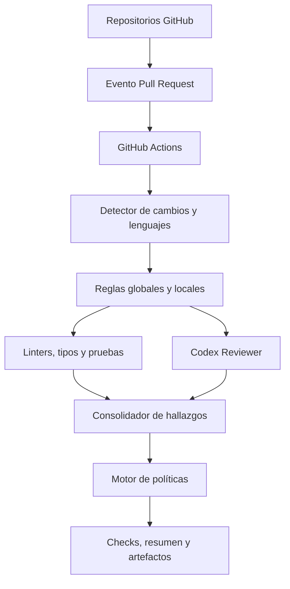

# 01 — Visión y arquitectura general

> Proyecto: **CodeGuardian AI** · Estado: diseño · Repositorio: https://github.com/The-Nasa/codeguardian-ai

## Problema
Los equipos trabajan en repositorios con lenguajes y convenciones distintas. Revisar manualmente cada pull request (PR) consume tiempo y puede pasar por alto errores, problemas de calidad y riesgos de seguridad.

## Objetivo
Crear un agente revisor multilenguaje, reutilizable entre repositorios GitHub, que analice PR mediante herramientas técnicas y OpenAI Codex, publique hallazgos y genere un check de calidad sin modificar ni fusionar código automáticamente.

## Alcance
- Activación principal: apertura y actualización de PR; `push` directo queda fuera del MVP.
- Lenguajes previstos: Python, JavaScript, TypeScript y Java; ampliables a Go, Docker, Terraform y otros.
- Primera entrega: Python con Ruff, pytest y revisión contextual con Codex.
- Integración: GitHub Actions y GitHub Agentic Workflows (`gh-aw`).
- Sin servidor propio, dashboard web ni despliegue de aplicaciones en el MVP.

## Arquitectura conceptual

## Componentes
| Componente | Responsabilidad |
|---|---|
| Event Trigger | Recibir evento y fijar SHA del commit |
| Repository Inspector | Detectar cambios y lenguajes |
| Rules Engine | Resolver reglas y precedencias |
| Static Analyzer | Ejecutar herramientas deterministas |
| Codex Reviewer | Revisar lógica, arquitectura y contexto |
| Findings Aggregator | Normalizar y deduplicar resultados |
| Quality Gate | Decidir pass/fail/incomplete y advertencias |
| GitHub Reporter | Publicar check, resumen y artefactos |
| Security Guard | Aislamiento, permisos y tratamiento de entradas no confiables |

## Decisiones
1. Separar análisis determinista y razonamiento de IA.
2. Un orquestador con adaptadores por lenguaje, no un agente completo por lenguaje.
3. Solo fallos verificables de reglas obligatorias bloquearán la integración en Standard.
4. Sin merges, correcciones ni despliegues automáticos en v1.
5. Versionar la distribución para repositorios consumidores.

## Hoja de ruta de alto nivel
1. MVP Python.
2. Adaptadores TypeScript/JavaScript y Java.
3. Instalación versionada en tres repositorios independientes.
4. Seguridad, observabilidad, medición de costo y precisión.

## Criterios de éxito
- PR Python analizado de extremo a extremo.
- Reporte con evidencia y referencia al commit.
- Check técnico reproducible y sin dependencia de disponibilidad de Codex.
- Configuración de repositorio validada.
- Sin credenciales expuestas ni ejecución privilegiada de PR externos.

## Riesgos
- Falsos positivos de IA: no bloquear únicamente por opinión del modelo.
- Costos de tokens y runners: limitar alcance, concurrencia y tiempo.
- Prompt injection en código y documentación: tratarlos como datos, nunca instrucciones.
- Variaciones de soporte de gh-aw: validar versión y sintaxis antes de implementar.
