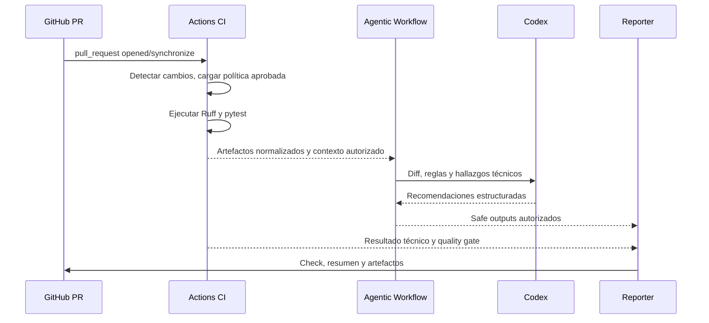

# 02 — Arquitectura híbrida y operación interna

> Perfil elegido: **Standard** · Estado: diseño

## Principios
- Los analizadores deterministas verifican reglas objetivas; Codex razona sobre contexto y cambios.
- El sistema debe degradar de manera explícita: si falla Codex, el análisis técnico conserva su resultado; la revisión IA queda `incomplete` si es requerida.
- Cada revisión está asociada a `repository`, `pr_number`, `head_sha`, `policy_version` y `run_id`.

## Secuencia de ejecución

> El diagrama es lógico: las dependencias entre jobs y el traspaso de artefactos deben validarse con las capacidades reales de `gh-aw`. No se supone que un job independiente pueda leer resultados de otro sin un mecanismo explícito.

## Módulos
| Módulo | Entrada | Salida |
|---|---|---|
| Configuration Manager | Política aprobada, perfil | Configuración efectiva |
| Change Inspector | Metadatos PR, diff | Inventario de archivos |
| Language Detector | Inventario, manifiestos | Lenguajes y adaptadores |
| Analyzer Engine | Código aislado, configuración | Hallazgos técnicos y estado |
| Codex Reviewer | Diff y contexto limitado | Hallazgos de IA propuestos |
| Aggregator | Hallazgos de ambos motores | Hallazgos únicos normalizados |
| Policy Engine | Hallazgos y ejecución | Decisión del quality gate |
| Reporter | Decisión, hallazgos, SHA | Check, comentario y artefactos |

## Separación de confianza
1. **Entrada no confiable:** PR, código, README, comentarios y configuración propuesta en la rama del PR.
2. **Política confiable:** configuración de rama protegida o repositorio central versionado.
3. **Análisis sin escritura:** lectura del diff y resultados, sin token de publicación ni secretos accesibles al código del PR.
4. **Publicación separada:** safe outputs / job de publicación con permisos mínimos y datos validados.
5. **Protección de ramas:** solo checks obligatorios configurados en GitHub pueden impedir merge.

## Modos de ejecución
- PR interno confiable: pruebas en runner aislado, secretos fuera del entorno de ejecución del código del PR.
- PR desde fork: modo restringido sin credenciales sensibles ni ejecución privilegiada; pruebas dinámicas solo en aislamiento apropiado.
- Cambio solo de documentación: revisión liviana, según política.
- Commit nuevo durante análisis: cancelar o marcar obsoleta la ejecución anterior.

## Estrategia multilenguaje
Un adaptador declara: `language`, `detect`, `supported_tools`, `required_runtime`, `run`, `normalize`, `timeout`. El núcleo no depende de Ruff, ESLint o Maven: consume resultados normalizados.

## Observabilidad
Medir: duración por fase, costo aproximado por PR, cobertura de archivos elegibles, fallos de infraestructura, falsos positivos revisados por humanos, y número de hallazgos por severidad.

## Límites iniciales propuestos (ajustables)
- Hasta 40 archivos relevantes por revisión IA.
- Cancelación de ejecuciones obsoletas.
- Tiempo máximo y presupuesto de IA por PR.
- Exclusión de binarios, builds y código generado.
- Reporte incompleto si el alcance supera límites obligatorios; nunca marcar pass fingiendo revisión completa.
