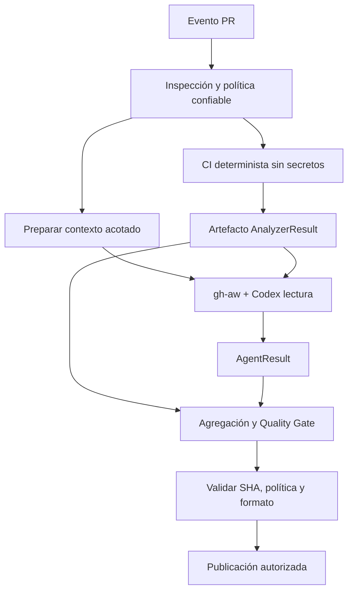
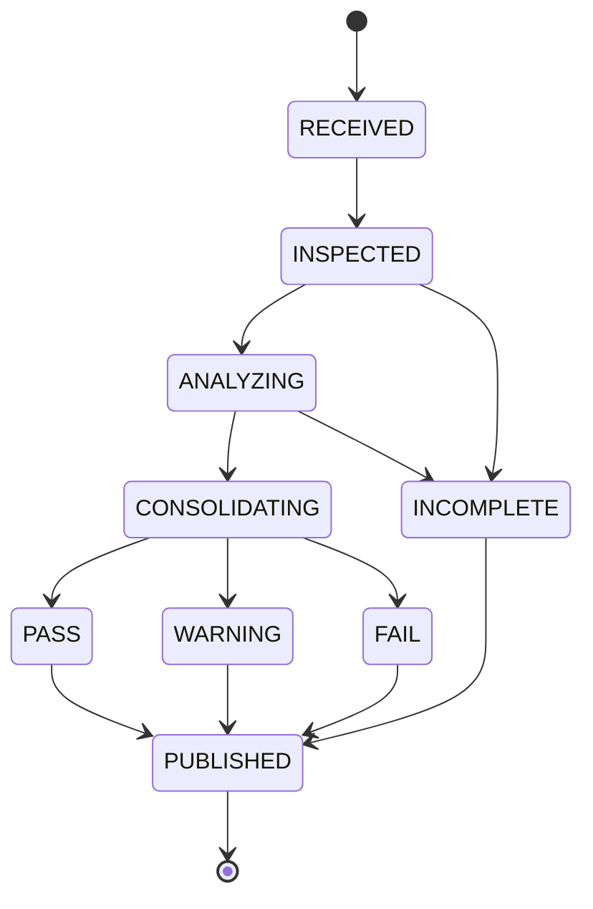

# 05 — Especificación técnica de implementación

> Estado: **diseño, sin código** · Basado en los documentos 01–04 · Perfil Standard

## Propósito
Traducir la arquitectura a contratos verificables, límites de confianza, dependencias entre jobs, manejo de errores y pruebas de integración. Este documento define *qué* implementar y *cómo comprobarlo*, no la implementación.

## 1. Identidad de revisión
Cada ejecución llevará una identidad inmutable:
- `repository_full_name`: owner/repo.
- `pull_request_number`: entero.
- `base_sha` y `head_sha`: commits exactos.
- `run_id` y `run_attempt`: ejecución GitHub.
- `policy_version`: versión efectiva de reglas.
- `analyzer_versions`: herramientas y versiones.
- `engine`: Codex y modalidad autorizada.

Ningún reporte se publica como vigente si `head_sha` ya no coincide con la cabeza del PR.

## 2. Contratos internos
### ReviewRequest
Entradas: identidad de revisión, inventario de archivos, diff acotado, política efectiva, límites de ejecución y nivel de confianza del evento.

### AnalyzerResult
Salidas: `tool`, `version`, `status` (`success`, `findings`, `error`, `skipped`), `duration_ms`, `findings[]`, `logs_artifact`, `coverage_scope`.

### AgentResult
Salidas: `status`, `findings[]`, `review_summary`, `context_scope`, `limitations`, `usage` (si disponible). Cada finding IA lleva `verification=suspected` por defecto hasta ser validado.

### QualityDecision
Salidas: `logical_status` (`PASS`, `WARNING`, `FAIL`, `INCOMPLETE`), `blocking_reasons[]`, `advisories[]`, `head_sha`, `policy_version`, `required_checks[]`.

### ReportBundle
Salidas: JSON normalizado, resumen Markdown, anotaciones validadas y metadatos de ejecución. El bundle es un artefacto, no una autorización de escritura.

## 3. Contrato del adaptador
Cada adaptador de lenguaje debe declarar:
- `id`, `version`, `languages`, `file_patterns`.
- `detect(project)` para decidir aplicabilidad.
- `requirements` (runtime y herramientas).
- `execute(context)` con timeout y aislamiento.
- `normalize(raw_result)` a AnalyzerResult.
- `supports_untrusted_pr` y restricciones de ejecución.

**Python v1:** Ruff para lint, pytest para pruebas; mypy y Bandit quedan como ampliaciones controladas según política.

## 4. Diseño de workflows y artefactos

El orden es lógico. Para una primera implementación se recomienda que el check técnico sea independiente del check de IA. Un check agregado es opcional y requiere un mecanismo fiable de espera y consumo de artefactos; no asumir interoperabilidad implícita entre workflows.

### Workflow CI técnico
- Evento `pull_request` (opened, synchronize, reopened).
- Permisos de lectura y ejecución sin secretos expuestos al código PR.
- Checkout de SHA exacto y dependencias controladas.
- Ejecutar Ruff/pytest; guardar resultados aun ante fallos.
- Emitir check obligatorio según configuración de branch protection.

### Workflow agente
- Markdown con frontmatter de evento, engine, permisos, tools y safe outputs.
- `engine: codex` sujeto a sintaxis/versiones validadas.
- Solo contexto necesario; no ejecutar comandos arbitrarios derivados de instrucciones del PR.
- Publicar mediante safe outputs o job con permisos mínimos, nunca con escritura directa desde el agente.
- Compilar a `.lock.yml` con `gh aw compile`; revisar diffs del generado.

## 5. Máquina de estados

`WARNING` se representa como conclusión GitHub exitosa con advertencias; `INCOMPLETE` no debe convertirse silenciosamente en success si una revisión requerida no se ejecutó.

## 6. Política de seguridad operacional
- No usar `pull_request_target` para ejecutar código del PR con tokens de escritura o secretos.
- No usar credenciales API en jobs que ejecutan código no confiable.
- Mantener un publicador separado que valide contenido, rutas y SHA.
- Fijar dependencias/acciones por referencias revisadas e inmutables cuando sea viable.
- Tratar texto de PR, código y comentarios como datos no confiables.
- No mostrar secretos encontrados en logs ni reportes.
- Revisar cambios del `.lock.yml` generado antes de merge.
- Permitir excepciones solo con registro de aprobador, alcance y vencimiento.

## 7. Errores y recuperación
| Falla | Resultado |
|---|---|
| Ruff detecta infracción no bloqueante | WARNING |
| pytest falla en suite obligatoria | FAIL |
| Codex sin cuota/credenciales y requerido | INCOMPLETE |
| Política inválida | INCOMPLETE / check de configuración fallido |
| Timeout de analizador obligatorio | INCOMPLETE |
| Reporte de IA con ruta inventada | Descartar anotación; registrar advertencia |
| PR cambia de SHA | Cancelar/no publicar resultado como actual |
| Fallo de publicación | Guardar artefacto y señalar publicación incompleta |

## 8. Pruebas de integración
- Fixtures de PR Python correcto, con lint, con tests fallidos, y con recomendaciones IA.
- Prueba de deduplicación entre Ruff y Codex.
- Prueba de compatibilidad de esquema y política protegida.
- Prueba de SHA obsoleto y comentario existente actualizable.
- Prueba de PR externo con instrucciones de prompt injection.
- Prueba de fallo de red / cuotas Codex sin falso PASS.
- Prueba de permisos del workflow y compilación estricta.

## 9. Requisitos previos para implementación
- Repositorio central: https://github.com/The-Nasa/codeguardian-ai
- Git y GitHub CLI autenticados.
- Extensión oficial `github/gh-aw` y versión fijada.
- Python y entorno de pruebas.
- GitHub Actions habilitado y permisos revisados.
- Método de autenticación de Codex y presupuesto aprobado.
- Branch protection/ruleset para check técnico obligatorio cuando se pruebe bloqueo real.

## 10. Entregables siguientes
1. ADR-001: separación de CI técnico y agente.
2. ADR-002: modelo de permisos y PR externos.
3. Esquema `codeguardian.yml` y `finding.schema.json`.
4. Matriz de pruebas y fixtures.
5. Primer PR de estructura base; implementación solo después de aprobar diseño.

## Fuentes técnicas oficiales
- GitHub Agentic Workflows: https://github.github.com/gh-aw/
- Creación de workflows: https://github.github.com/gh-aw/setup/creating-workflows/
- Compilación: https://github.github.com/gh-aw/reference/compilation-process/
- Proyecto oficial: https://github.com/github/gh-aw

> La sintaxis de gh-aw, modalidades de autenticación y límites de la plataforma pueden cambiar. Validar documentación y versiones fijadas al iniciar implementación.
